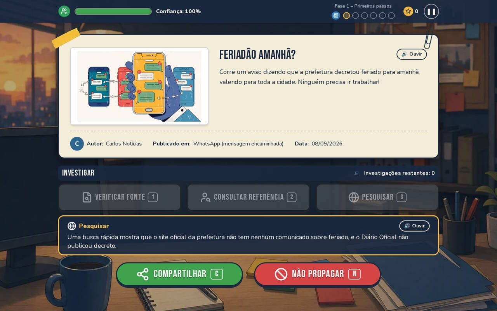

# Fake Hunter

Jogo educativo web sobre desinformação. Você é o checador de fatos de Vale Verde: lê as
notícias que chegam pelo WhatsApp, redes sociais e sites, investiga com ferramentas limitadas e
decide se compartilha ou bloqueia. Depois de cada decisão, o jogo explica por que a notícia era
verdadeira, falsa ou meia verdade, e guarda os sinais aprendidos no **Caderno do Checador**.



## Rodar

```bash
npm install
npm run dev        # http://localhost:3000
npm run build      # build de produção (página estática)
npm start          # serve o build (necessário para testar o modo offline)
```

Verificações (rode antes de entregar):

```bash
npm run lint
npm run typecheck
npm test           # 56 testes: regras, conteúdo, classificação e pacotes do modo professor
```

## O que tem no jogo

- 4 fases, 24 notícias, 15 fontes; narrativa com introdução, abertura de fase e tela de conclusão
  com selo de desempenho e certificado.
- Fase 4 "Olho clínico": a ficha das fontes não mostra se são confiáveis, e as falsas se
  entregam por erros de português; botão de dica (lâmpada).
- Tutorial guiado, carimbo de veredito, explicação com os sinais de cada notícia.
- Interface responsiva (computador e celular) e PWA instalável que funciona offline.
- Acessibilidade: texto ampliável, alto contraste, reduzir animações, leitura em voz alta,
  legendas de som, atalhos de teclado e suporte a leitores de tela.
- Relatório de partidas com exportação CSV (para testes com usuários e uso em sala).
- Modo professor: trocar as notícias por um pacote JSON próprio, sem programar.

## Documentação

Ver [`docs/`](docs/README.md): concepção, game design, arquitetura, acessibilidade, formato do
conteúdo, metodologia e testes, limitações e roteiro de apresentação.

## Estrutura

```
app/           layout, página, manifesto do PWA e estilos globais
components/    telas e componentes de interface
lib/           regras do jogo, conteúdo, preferências, memória, áudio e voz
data/          conteúdo original em JSON (fontes, notícias, fases, sinais)
tests/         testes automatizados (Vitest)
public/        arte, ícones do app e service worker
docs/          documentação do projeto
scripts/       migração do conteúdo do protótipo em Unity
```

## Áudio

Os efeitos e as músicas do menu vêm do protótipo em Unity (branch `melhorias-gameplay`) e ficam
em `public/audio/`: `clique.mp3`, `acerto.mp3`, `erro.mp3`, `proxima_fase.mp3`, `game_over.mp3`,
`menu_1.mp3`, `menu_2.mp3` e `menu_3.mp3` (o menu sorteia uma das três). Para trocar um som,
substitua o arquivo mantendo o nome. Se algum faltar, o efeito vira um bipe sintetizado.
