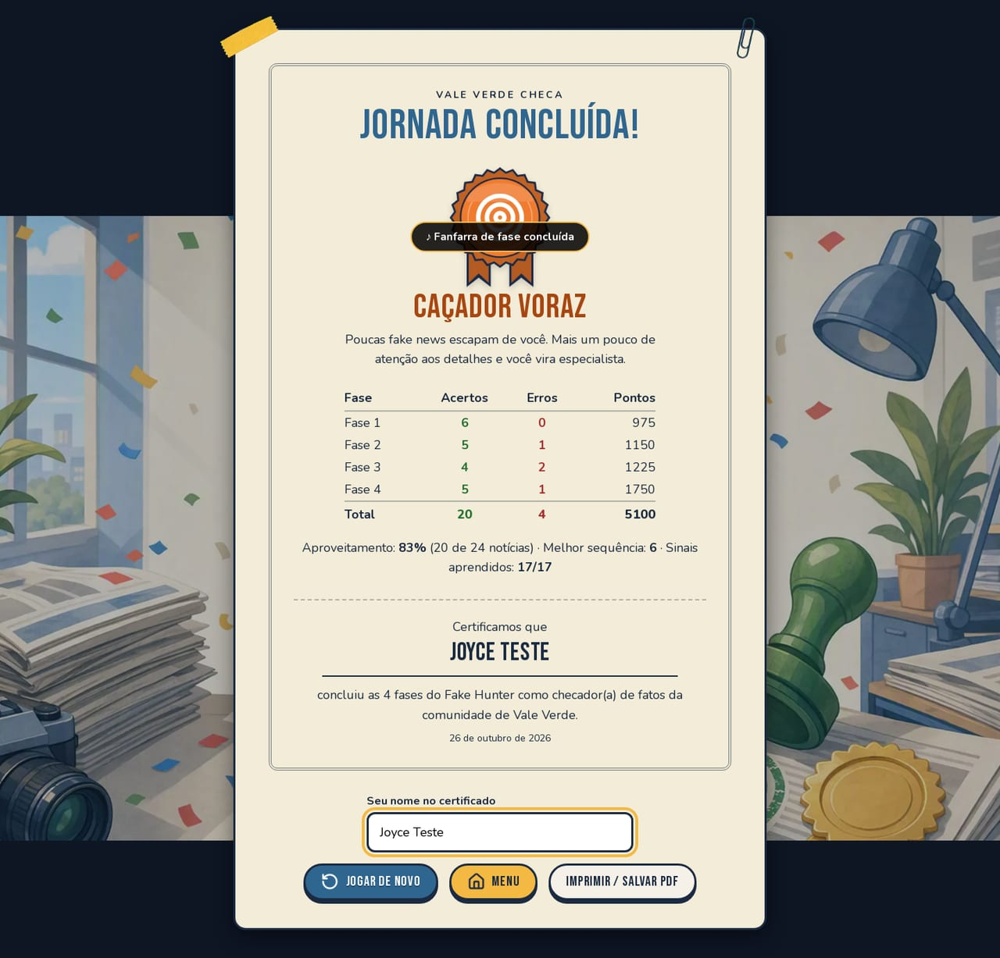

# 2. Game design

## Narrativa

O jogador é contratado pelo **Vale Verde Checa**, a agência de checagem da cidade fictícia de
Vale Verde. A coordenadora, Marta Ribeiro, apresenta a missão numa mensagem de boas-vindas e
reaparece na abertura de cada fase, comentando a evolução dos boatos:

| Fase | Tema | Abertura (resumo) |
| --- | --- | --- |
| 1 – Primeiros passos | Casos simples, aprender as ferramentas | "Primeiro dia… use as ferramentas sem pressa" |
| 2 – Meia verdade | Exagero, dado velho, manchete distorcida | "Os boatos ficam mais espertos" |
| 3 – Caçador experiente | Site clonado, foto antiga, fonte enganosa | "Os golpistas perceberam que você está de olho" |
| 4 – Olho clínico | Fontes falsas que imitam órgãos oficiais; ficha sem status | "Repare em como cada fonte escreve" |

Ao concluir a Fase 4, o jogador vê a **tela de conclusão**: um selo de desempenho, o resultado
de cada fase e um certificado com o nome dele, que pode ser impresso.

## Fluxo de telas

```
Menu ─► Introdução (só na 1ª vez) ─► Abertura da fase ─► Tutorial (só na 1ª notícia da 1ª vez)
                                          │
                                          ▼
                     ┌──── Notícia: ler → investigar (até 2) → decidir ◄───┐
                     │                         │                           │
                     │                 carimbo + explicação ───────────────┘
                     │                         │ (última notícia)
                     │                         ▼
                     │                  Fim de fase ─► próxima fase
                     │                  (última fase ─► tela de conclusão com selo)
                     │
                     └─ confiança chegou a 0 ─► Game over ("Você foi demitido!")
```

O menu também dá acesso a: Como jogar, Caderno do Checador, Acessibilidade, Relatório de
partidas e Modo professor. Durante a partida, o botão de pausa (ou Esc) abre as opções de
acessibilidade.

## Loop de cada notícia

1. **Leitura** — cartão com título, texto, autor, canal de publicação, data e imagem.
2. **Investigação** — até 2 das 3 ferramentas; cada uma só pode ser usada uma vez:
   - *Verificar Fonte*: procedência da mensagem (ex.: "o link leva a um site que não é o do banco").
   - *Consultar Referência*: nome, status (Confiável / Não confiável / Desconhecida) e histórico do autor.
   - *Pesquisar*: o que uma busca em outros lugares revela.
3. **Decisão** — *Compartilhar* ou *Não Propagar*.
4. **Carimbo e explicação** — o cartão recebe um carimbo (VERDADEIRA / FALSA / MEIA VERDADE) e
   abre o painel com "Você acertou/errou", o veredito, a explicação educativa e os sinais
   daquela notícia (os inéditos aparecem como "novo no caderno!").

## Regras exatas

### Acerto

- Cada notícia tem veredito `Verdadeira`, `Falsa` ou `ParcialmenteVerdadeira`.
- **Só notícias totalmente verdadeiras devem ser compartilhadas.**
- `acertou = (compartilhou == (veredito == Verdadeira))`.

### Confiança da comunidade

- Barra de 0 a 100, começa em 100.
- Acerto: **+5** (teto 100). Erro: **−20** (piso 0).
- Cor: > 60 verde, 31–60 amarelo, ≤ 30 vermelho.
- Chegar a 0 encerra a fase na hora (game over), sem mostrar a explicação.

### Pontuação

- Multiplicador por dificuldade: Fácil 1, Média 2, Difícil 3.
- Acerto: `pontos += 100 × multiplicador + 25 × (sequência − 1)`, em que a sequência já inclui o
  acerto atual (o primeiro acerto não ganha bônus).
- Erro: a sequência zera; não há perda de pontos.
- Registra acertos, erros e melhor sequência.

Exemplo verificado em teste: acertar as 6 notícias da Fase 1 dá **975 pontos**.

### Progressão

- Fases encadeadas, 6 notícias cada, em ordem fixa (há a opção `embaralhar`, desligada).
- Confiança e pontuação **reiniciam a cada fase**.
- No fim de fase: *Jogar de novo*, *Próxima fase* e *Menu*. A última fase vai direto para a
  tela de conclusão.
- *Jogar* no menu sempre começa uma nova jornada pela primeira fase.

### Regras especiais por fase

- `ocultarStatusDaFonte`: *Consultar Referência* mostra o nome e o histórico da fonte, mas não
  diz se ela é confiável. Usado na Fase 4, em que as fontes falsas imitam órgãos oficiais e se
  entregam por erros de português ("Defeza Civil", "Portal Ofissial", "Ministerio da Previdência
  Sosial", "Portal Ciênsia Hoje").
- `dica`: mostra um botão de lâmpada (atalho **D**) que abre um balão com a dica da fase. O balão
  fecha ao decidir e ao passar para a próxima notícia.


### Tela de conclusão e selos

O selo considera todas as fases concluídas na jornada (se o jogador repetir uma fase, vale o
resultado mais recente). Aproveitamento = acertos ÷ notícias decididas.

| Aproveitamento | Selo |
| --- | --- |
| 100% (nenhum erro) | Especialista |
| 80% ou mais | Caçador voraz |
| 60% ou mais | Caçador vegetariano |
| abaixo de 60% | Caçado pelas fake news |

Mesmo chegando ao fim sem ser demitido, o jogador pode receber "Caçado pelas fake news". Os
limites ficam em [`lib/classificacao.ts`](../lib/classificacao.ts) e são testados em
[`tests/classificacao.test.ts`](../tests/classificacao.test.ts).



Todas essas regras estão em [`lib/regras.ts`](../lib/regras.ts) e cobertas por
[`tests/regras.test.ts`](../tests/regras.test.ts).

## Conteúdo

24 notícias (9 verdadeiras, 10 falsas, 5 parcialmente verdadeiras; 6 fáceis, 6 médias e 12
difíceis), 15 fontes e 17 sinais no Caderno do Checador (13 sinais de alerta e 4 boas
práticas). Os textos das notícias e das fontes vieram na íntegra do protótipo em Unity (a Fase 4
veio da branch `feature/fase4-conclusao`).

### Casos de destaque

| Notícia | Por que está no jogo |
| --- | --- |
| Lote falsificado de remédio (Fase 3) | Fonte **não confiável** compartilha alerta **verdadeiro**: quem bloqueia, erra |
| Nova espécie de sapo (Fase 3) | Fonte **desconhecida** e texto informal, mas conteúdo verdadeiro |
| Prefeito investigado (Fase 3) | Usa o nome do jornal confiável num **site clonado** |
| Ônibus de graça (Fase 2) | Fato real **exagerado** ("todos os domingos"): meia verdade |
| Celular causa câncer (Fase 2) | Estudo real em ratos, **manchete distorcida** |
| 14º salário (Fase 4) | Golpe assinado por "Ministerio da Previdência **Sosial**" |
| Café e coração (Fase 4) | Estudo real exagerado por um site que escreve "Ciên**s**ia" |
| Cursinho UFVV (Fase 4) | Verdadeira: sem status da fonte, o jogador confia no texto revisado e na confirmação |
