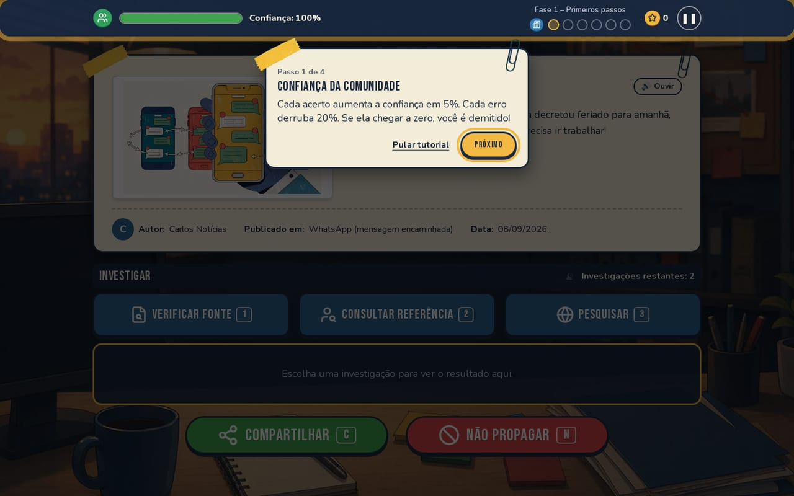
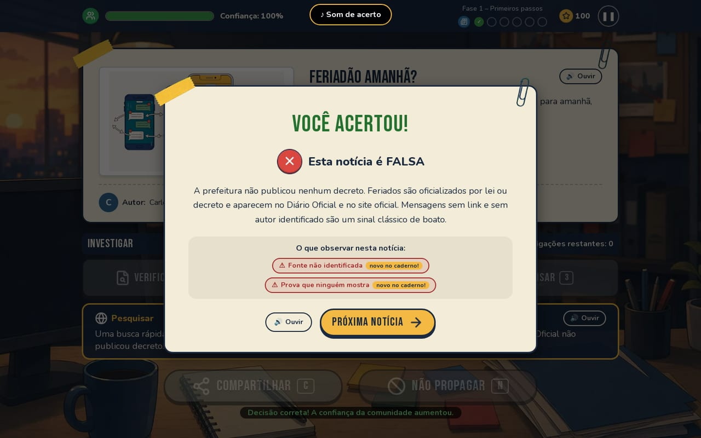
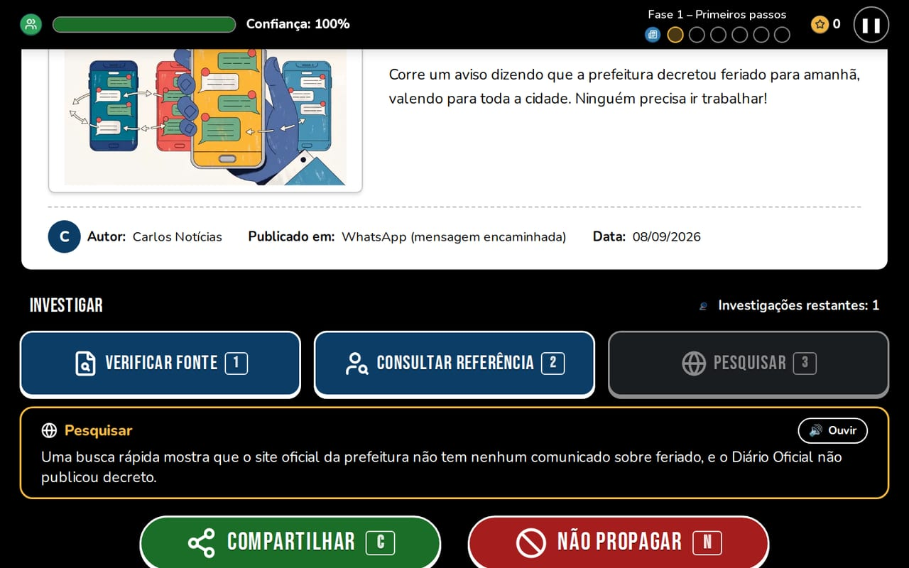
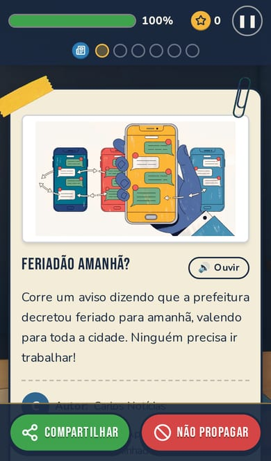

# 4. UX, UI e acessibilidade

## Identidade visual

Tema de redação de jornal e mural de investigação: cartão de papel com fita adesiva e clipe,
carimbo de veredito, post-its, lupa. Ilustração flat/cartoon, reaproveitada do protótipo.

- **Tipografia:** Bebas Neue em títulos e botões, Nunito no texto (as mesmas do protótipo, ambas
  com licença OFL, carregadas pelo `next/font`).
- **Ícones:** [Lucide](https://lucide.dev) nos botões (licença ISC, em
  `public/img/ui/icones/LICENCA_lucide.txt`), brancos nos botões escuros e azuis nos claros;
  selos redondos na HUD e no veredito; selos de classificação na tela de conclusão.
- **Cores dos botões:** verde para avançar/jogar, vermelho para bloquear/sair, azul para
  investigar/repetir, amarelo para menu, fechar e próxima notícia.

| Cor | Hex | Uso |
| --- | --- | --- |
| Azul-marinho | `#1B2A41` | Fundos, HUD, bordas |
| Azul | `#2F6690` | Botões neutros, títulos |
| Amarelo | `#F4B942` | Destaque, ação principal |
| Verde | `#3FA34D` | Verdadeiro / compartilhar |
| Vermelho | `#D64545` | Falso / bloquear |
| Branco-papel | `#F5F1E8` | Cartões |
| Cinza | `#8A94A6` | Texto secundário |

Para texto sobre o papel, verde e vermelho usam versões escurecidas (`#24712F`, `#A92E2E`)
que atingem contraste AA.

## Decisões de UX

- **Tutorial guiado** na primeira notícia: destaca, em 4 passos, a confiança, o cartão, a
  investigação e a decisão. Pode ser pulado e revisto depois.
- **Abertura de fase** explica o tema da fase antes de começar.
- **Progresso visível**: bolinhas na HUD mostram acertos (✓) e erros (✕) de cada notícia.
- **Carimbo** sobre o cartão antes da explicação: reforça o veredito de forma visual e coerente
  com a narrativa de redação.
- **Explicação sempre**: mesmo acertando, o jogador vê o porquê e os sinais da notícia.
- **Decisão no alcance do polegar**: no celular, os botões de decisão ficam fixos na base da tela.
- **Botões nunca dependem só da cor**: decisão tem ícone e texto; o status da fonte tem
  símbolo (✔ ✖ ?) e texto.

## Recursos de acessibilidade

Disponíveis no menu (**Acessibilidade**) e durante a partida (botão de pausa ou **Esc**). As
escolhas ficam salvas no navegador.

| Recurso | Para quem | Como funciona |
| --- | --- | --- |
| Tamanho do texto (A, A+, A++) | Baixa visão, leitura em telas pequenas | Escala toda a interface (100%, 115%, 130%) |
| Alto contraste | Baixa visão, telas ao sol | Fundos sólidos, texto preto/branco, bordas fortes, sem ilustrações de fundo |
| Reduzir animações | Sensibilidade a movimento | Desliga carimbo, transições e destaques pulsantes; também respeita `prefers-reduced-motion` do sistema |
| Leitura em voz alta | Baixa visão, baixa alfabetização, dislexia | Botão "Ouvir" na notícia, no resultado e na explicação; opção de leitura automática |
| Legendas de som | Surdez, jogar sem áudio | Aviso visual quando toca som de acerto, erro, fim de fase ou game over |
| Som liga/desliga | Ambientes silenciosos | Desliga efeitos e música |
| Atalhos de teclado | Mobilidade reduzida, uso sem mouse | 1/2/3 investigar, C compartilhar, N não propagar, L ouvir, Esc pausar |
| Leitores de tela | Cegueira | HTML semântico, rótulos ARIA, anúncio dos resultados (`aria-live`), barra de confiança como `progressbar`, modais com `aria-modal` e fundo inerte |
| Foco visível | Navegação por teclado | Contorno amarelo de 4px em todo elemento focado |

## Diferentes dispositivos

O layout é responsivo, testado em computador (1440×900 e 1280×800) e celular (iPhone 13, 390×664):

- **Computador:** cartão com imagem ao lado do texto; investigação em linha; decisão abaixo.
- **Celular:** cartão em coluna; HUD compacta; investigação em três botões lado a lado; decisão
  fixa na base, com área segura para telas com entalhe.
- **Instalável (PWA)** pelo navegador e jogável **offline** depois da primeira visita (offline verificado no Chromium; a instalação em aparelhos reais ainda precisa ser testada).
- Botões de ação com pelo menos 48px de altura (os botões "Ouvir" e de pausa são menores, 32–44px).

## Medições

Lighthouse 12, perfil móvel (CPU e rede limitadas), build de produção:

| Categoria | Nota |
| --- | --- |
| Desempenho | 96 |
| Acessibilidade | 100 |

Métricas: FCP 0,8 s · LCP 2,6 s · TBT 80 ms · CLS 0.

O Lighthouse avalia a tela inicial; as outras telas foram verificadas manualmente e com testes
automatizados de navegador (ver [Metodologia e testes](06-metodologia-testes.md)).
